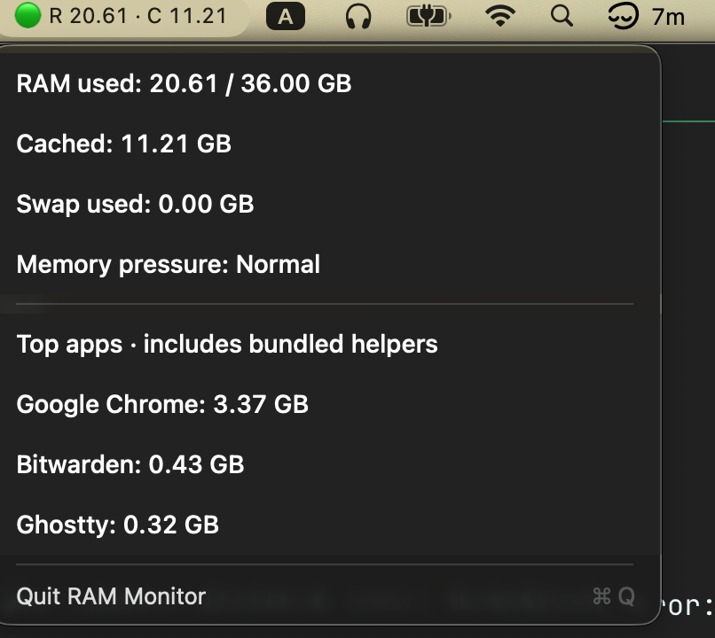

# RAM Monitor

## TLDR

<p align="center">
  
</p>

A tiny macOS menu-bar app showing RAM, cache, swap, memory pressure, and the top three apps by memory. Minimal footprint(<20Mb in RAM).

Requires macOS 13+, Command Line Tools(for `swiftc`), and optionally `just`(for convenient building).

The only reason why this exists is cause I have trouble with keeping track of my RAM usage and want to have
something in the task bar.

```sh
just run    # Build and launch
just build  # Build build/RAM Monitor.app
just check  # Check live readings
```

Quit an existing copy before launching a new build. The app is ad-hoc signed and not notarized.

## Screenshots

<p align="center">
  
</p>

## License

[0BSD license](LICENSE)
